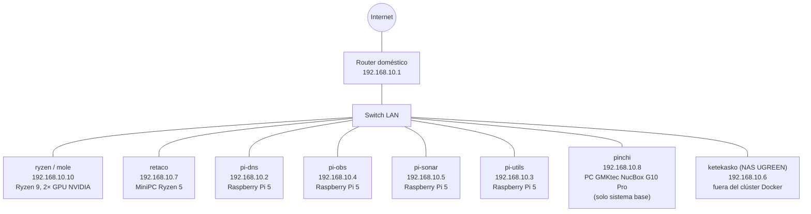
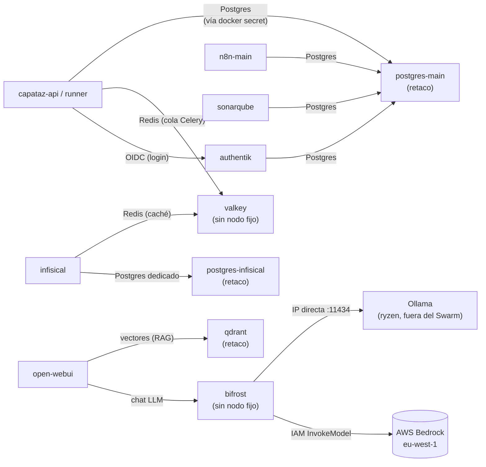
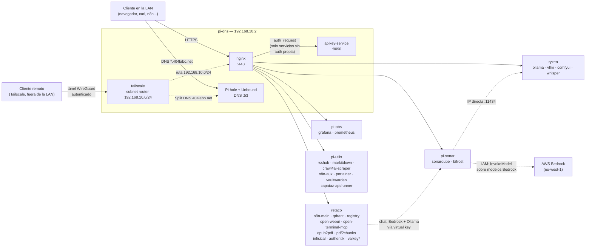
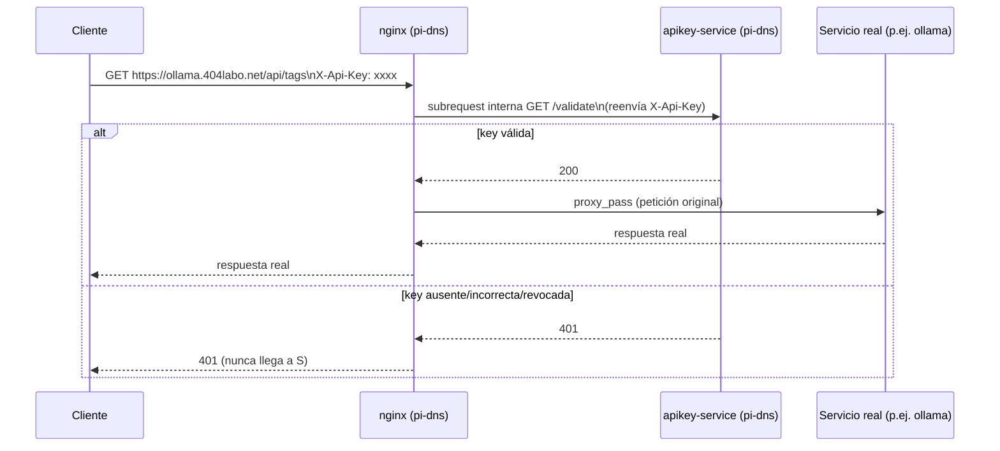
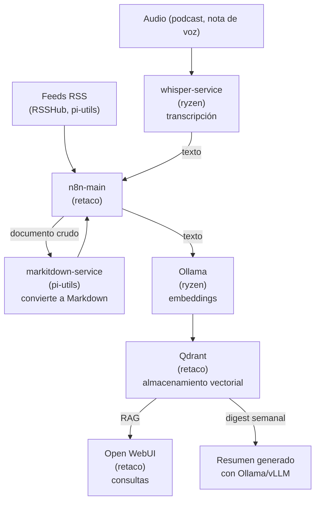
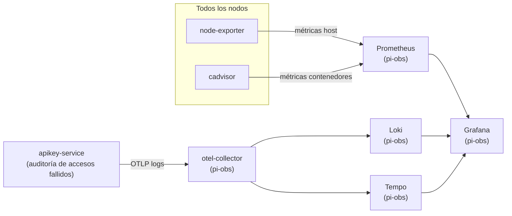

# 01 — Topología del clúster

## Qué es este clúster

⚠️ Esta sección describe el clúster **tal como era antes de Docker Swarm** (siete nodos, sin `miugarita` todavía, nginx como puerta de entrada) — se mantiene como referencia histórica, igual criterio que la sección "Estado actual" más abajo explica para el resto del documento. `miugarita` (2026-09-29, `docs/39-instalacion-miugarita.md`) se dio de alta directamente como octavo nodo/sexto miembro del Swarm ya existente, no formó parte nunca de esta topología de siete nodos previa a Swarm. Para el roster de nodos vigente hoy, ver la tabla de la sección "Estado actual" más abajo.

Se trata de siete nodos conectados a la misma red local doméstica. Docker Swarm todavía no está desplegado (mejora 33, `docs/22-mejoras-futuras.md`, en backlog) — hoy cada nodo tiene su propio fichero `docker-compose.yml` independiente, y se gestiona a mano (o mediante los scripts de `shared/scripts/`) por SSH. El nodo `pi-dns` actúa como única "puerta de entrada", mediante nginx y un sistema propio de claves de API (`apikey-service`); el resto de los nodos no son directamente accesibles por su nombre de host sin pasar antes por ese punto.

| Nodo | IP | Función en una frase |
|---|---|---|
| `ryzen` (alias `mole`) | 192.168.10.10 | Cómputo con GPU: modelos de lenguaje (Ollama/vLLM), transcripción de audio, generación de imágenes |
| `retaco` | 192.168.10.7 | Datos y automatización: PostgreSQL compartido, Qdrant, n8n, Open WebUI, gestor de secretos (Infisical), SSO (Authentik) |
| `pi-dns` | 192.168.10.2 | DNS interno (Pi-hole + Unbound), subnet router de Tailscale y servidor NUT del SAI — fuera del Swarm |
| `pinchi` | 192.168.10.8 | Swarm (worker): Portainer, Vaultwarden, n8n-aux, RSSHub, markitdown…, runner de Forgejo Actions. Ver `docs/30-instalacion-pinchi.md` |
| `miugarita` | 192.168.10.9 | Swarm (worker): observabilidad (alias `observability.404labo.net`) y SonarQube. Ver `docs/39-instalacion-miugarita.md` |
| `pi-obs`, `pi-sonar`, `pi-utils` | 192.168.10.4 / .5 / .3 | **Sin servicios desde 2026-10-08** (Raspberry Pi fuera del Swarm): solo `nut-upsmon`, encendidas como reserva |

> **Actualización 2026-10-08 — el Swarm son ahora 3 minipcs (`retaco`, `pinchi`, `miugarita`).** Las tres Raspberry Pi salieron del Swarm y sus servicios se repartieron entre los minipcs (historia y lecciones en `docs/31-docker-swarm.md`). **Los diagramas y las secciones por nodo de más abajo ("5 managers", `pi-obs`, `pi-sonar`, `pi-utils`) describen el estado anterior y se conservan como histórico**: para saber dónde corre algo hoy, `docker service ps <servicio>` o la tabla de `README.md`. Observabilidad y SonarQube están fijados a `miugarita`; Valkey y el resto de servicios sin nodo fijo flotan entre los 3.

> La misma red local aloja además un octavo dispositivo, el NAS UGREEN NASync `ketekasko` (192.168.10.6) — no es un nodo del clúster Docker (no tiene `docker-compose.yml` ni directorio propio en este repo), pero sí resuelve por DNS interno y aparece como tarjeta en el panel `home.404labo.net`. Detalle completo en `docs/21-configuracion-nas-ugreen.md`.

## Diagrama físico



## Estado actual: servicios en Docker Swarm (2026-08-31)

⚠️ **Esta sección refleja el estado real tras la migración a Docker Swarm y la revisión de `constraints`/NFS del 2026-08-31.** El resto de este documento (a partir de "Arquitectura de servicios — pi-dns como puerta de entrada", que sigue abajo) describe la topología **previa a Swarm** (nginx como puerta de entrada, hostnames `*.404labo.net`, un `docker-compose.yml` independiente por nodo) — se mantiene como referencia histórica, no como estado vigente. Para la topología actual: `docker-swarm/README.md`, `docs/31-docker-swarm.md` y `docs/32-manual-operaciones-swarm.md`.
>
> **Actualización 2026-09-29**: `miugarita` (192.168.10.9) se unió al Swarm como sexto nodo (`docs/39-instalacion-miugarita.md`), sin servicios de aplicación asignados todavía — los diagramas de constraints/NFS de abajo no la incluyen porque, a día de hoy, no aloja nada. El mismo día, un incidente real de migración de red dejó a `retaco` como el **único** nodo con estatus real de manager (bug de dirección Raft obsoleta, no una decisión de diseño) — `pi-obs`/`pi-sonar`/`pi-utils`/`pinchi`/`miugarita` son hoy workers, no los "5 managers" que describía el diseño original de la mejora 33. Ver `docs/31-docker-swarm.md` para el detalle del incidente.

### Dónde vive cada servicio: nodo fijo, sin nodo fijo, y mapeos NFS

```mermaid
flowchart TB
    subgraph retaco_node["retaco -- 192.168.10.7 (constraint fijo)"]
        postgres_main["postgres-main"]
        qdrant_svc["qdrant"]
        infisical_svc["infisical +\npostgres-infisical"]
    end

    subgraph piobs_node["pi-obs -- 192.168.10.4 (constraint fijo)"]
        obs_stack["loki · tempo · prometheus\ngrafana · otel-collector\npostgres-exporter"]
    end

    subgraph pisonar_node["pi-sonar -- 192.168.10.5 (constraint fijo)"]
        sonarqube_svc["sonarqube\ndata/ en disco local\n(mejora 44: intento de\nmover a pinchi, revertido)"]
    end

    subgraph pinchi_node["pinchi -- 192.168.10.8 (constraint fijo)"]
        portainer_svc["portainer-server\ndisco local (NVMe)"]
        vaultwarden_svc["vaultwarden\ndisco local (NVMe)"]
    end

    subgraph floating["Sin constraint -- Swarm elige entre los 3 nodos"]
        authentik_svc["authentik-server / worker"]
        bifrost_svc["bifrost"]
        capataz_svc["capataz-api / runner / frontend"]
        epub2pdf_svc["epub2pdf-service"]
        pdf2chunks_svc["pdf2chunks-service"]
        n8nmain_svc["n8n-main"]
        n8naux_svc["n8n-aux"]
        openterminal_svc["open-terminal-mcp"]
        openwebui_svc["open-webui"]
        registry_svc["registry"]
        rsshub_svc["rsshub"]
        valkey_svc["valkey"]
        apikey_svc["apikey-service"]
        markitdown_svc["markitdown-service"]
        crawl4ai_svc["crawl4ai-scraper-service"]
    end

    subgraph global_mode["mode: global -- una réplica en cada uno de los 3 nodos"]
        traefik_svc["traefik"]
        portagent_svc["portainer-agent"]
        nodeexp_svc["node-exporter · cadvisor"]
    end

    NAS[("NAS ketekasko\n/mnt/nfs-data\nNFSv3, montado en los 3 nodos")]

    authentik_svc -.->|"authentik/{data,certs}"| NAS
    capataz_svc -.->|"capataz/api-alembic\n(solo lectura)"| NAS
    epub2pdf_svc -.->|"epub2pdf/{input,output}"| NAS
    pdf2chunks_svc -.->|"pdf2chunks/{input,output}"| NAS
    n8nmain_svc -.->|"n8n-main/data"| NAS
    n8naux_svc -.->|"n8n-aux/data ⚠️ SQLite activo"| NAS
    openterminal_svc -.->|"open-terminal-mcp/home"| NAS
    openwebui_svc -.->|"open-webui/data\n(cache/ es tmpfs, no NFS)"| NAS
    registry_svc -.->|"registry/{data,auth}\n(~32G)"| NAS
    sonarqube_svc -.->|"sonarqube/extensions\n(data/ NO va por NFS)"| NAS
```



> **`n8n-aux` es el único mapeo NFS marcado con ⚠️** porque `database.sqlite`+`-wal`+`-shm` es una base de datos real con escritura activa (no solo caché/config) — se aceptó el riesgo de NFS a propósito, a diferencia de `portainer-server`/`vaultwarden`/`sonarqube`, que tienen el mismo tipo de estado (base de datos embebida y/o clave privada real) pero se resolvieron moviéndolas a disco local en `pinchi`/`pi-sonar` en vez de NFS.
>
> **Dos servicios sin nodo fijo tienen bind-mounts que tampoco pasan por NFS**, por sensibilidad del contenido (contraseña en claro / clave privada TLS): `valkey` (`users.acl`, `tls/`) y el binario del CLI de `infisical` (usado por prácticamente todos los servicios de la lista "Sin constraint") están replicados a una ruta idéntica en los 5 managers (`/srv/homelab/valkey/...`, `/srv/homelab/infisical/infisical-cli/...`) en vez de vivir en el NAS — así no viajan en claro por la red cada vez que un contenedor arranca. El binario de `infisical`, además, está organizado por arquitectura de CPU (`x86-64/`/`aarch64/`) con un symlink que resuelve solo, para que el mismo `docker-compose.yml` funcione sin cambios aterrice donde aterrice.
>
> `apikey-service`/`markitdown-service`/`crawl4ai-scraper-service` nunca tuvieron `constraints` -- son los primeros servicios migrados a Swarm (Fase 2/3b, `docs/31-docker-swarm.md`), sin estado local real desde el principio.

### Dependencias reales entre servicios



> No incluido en el diagrama para no saturarlo: **11 de los servicios sin `constraints`** (`authentik`, `bifrost`, `capataz-api/runner`, `n8n-main`, `n8n-aux`, `open-terminal-mcp`, `open-webui`, `rsshub`, `sonarqube`, `vaultwarden`, `apikey-service`) obtienen sus credenciales reales de **Infisical** (`infisical.404labo.net`) en cada arranque, vía el patrón `infisical login` + `infisical run` (ADR 0001) — es, con diferencia, la dependencia más repetida de todo el clúster, pero dibujarla como una flecha por servicio no aportaría información nueva.

---

## Arquitectura de servicios — pi-dns como puerta de entrada

Todo acceso HTTPS por nombre de host (`*.404labo.net`) entra por `nginx`, en `pi-dns`, que lo reenvía al nodo correspondiente. Los servicios que carecen de autenticación propia pasan, además, por `apikey-service` (también en `pi-dns`) antes de llegar al servicio real — ver `docs/06-instalacion-pi1-dns.md`.



> `qdrant` y `postgres-main` (en retaco) tienen su **propia** autenticación nativa (clave de API en el caso de Qdrant, usuario y contraseña en el de Postgres): no pasan por `apikey-service`, ya que sería una capa redundante. Consulta `docs/06-instalacion-pi1-dns.md` para ver el detalle de qué servicio está protegido con qué mecanismo.

> `valkey*` (retaco, marcado con asterisco en el diagrama) **no** pasa por `nginx` en absoluto — es un alias DNS directo (`valkey.404labo.net` → IP de retaco), igual que `postgresql.404labo.net`: el protocolo RESP no es HTTP, así que no puede convivir con los vhosts del proxy inverso. Protegido por ACL propia + TLS con la CA interna, no por `apikey-service`. Detalle completo en `shared/dns/dns-records.md` (sección "Alias directos") y `docs/25-valkey-cache.md`.

> `capataz-api`/`capataz-runner` (pi-utils) tampoco tienen hostname `*.404labo.net` propio — el frontend de Capataz se sirve estático desde `nginx` en `home.404labo.net` (sin contenedor propio, ver `docs/28-capataz-consola-automatizacion.md`), y ese mismo bloque de `nginx` reenvía `home.404labo.net/api/` directo a `pi-utils:8000` (`capataz-api`). `capataz-runner` no expone ningún puerto en absoluto, solo consume la cola de Valkey.

> El acceso remoto autenticado (desde fuera de la LAN) se hace mediante Tailscale, con un enrutador de subred en `pi-dns` — el detalle completo está en `docs/18-tailscale.md`.

## Inventario de servicios por nodo

Extraído directamente de los 7 ficheros `docker-compose.yml`/`docker-compose.observability.yml` del repositorio y del `nginx.conf` real desplegado en `pi-dns` (verificado por SSH, sin drift frente al versionado en `pi-dns/config/nginx/nginx.conf` en el momento de escribir esto). "Sin límite" significa que el servicio no fija `mem_limit`/`mem_reservation`/`cpus` (sintaxis Compose v2) — nada en este repo usa `deploy.resources.limits`, que es sintaxis de Swarm y `docker compose up` la ignora en silencio.

### `ryzen` (192.168.10.10)

| Servicio | Restricciones | Volúmenes | Puerto en nodo | Domain name (nginx) |
|---|---|---|---|---|
| `ollama` | Sin límite mem/CPU; reserva GPU NVIDIA (`count: all`) | `ryzen/ollama/models:/root/.ollama` | `11434:11434` | `ollama.404labo.net` (protegido con `apikey-service`) |
| `whisper-service` | Sin límite mem/CPU; reserva GPU NVIDIA fija (`device_ids: ["1"]`, RTX 3070) | `ryzen/whisper/models:/root/.cache/whisper`; `ryzen/whisper/cache:/tmp/whisper-cache` | `9800:9800` | `whisper.404labo.net` |
| `vllm` | Sin límite mem/CPU; reserva GPU NVIDIA fija (`device_ids: ["0"]`, RTX 5070) | `ryzen/vllm/models:/root/.cache/huggingface` | `8010:8000` | `vllm.404labo.net` (protegido con `apikey-service`) |
| `comfyui` | Sin límite mem/CPU; reserva GPU NVIDIA fija (`device_ids: ["1"]`, RTX 3070) | `ryzen/comfyui/{models,input,output,user,custom_nodes}` | `8188:8188` | `comfyui.404labo.net` (protegido con `apikey-service`) |
| `node-exporter` | Sin límite | `/proc`, `/sys`, `/` (todos `:ro`) | `9100:9100` | No expuesto vía nginx |
| `cadvisor` | Sin límite | `/`, `/var/run`, `/sys`, `/var/lib/docker`, `/dev/disk` (todos `:ro`) | `8081:8080` | No expuesto vía nginx |
| `portainer-agent` | Sin límite | `docker.sock`; `/var/lib/docker/volumes` | `9001:9001` | No expuesto vía nginx |
| `watchtower` | Sin límite | `docker.sock:ro` | Sin puerto publicado | No expuesto vía nginx |
| `promtail` | Sin límite | `promtail-config.yaml:ro`; `data`; `docker.sock:ro`; `/var/lib/docker/containers:ro` | Sin puerto publicado | No expuesto vía nginx |

### `retaco` (192.168.10.7)

| Servicio | Restricciones | Volúmenes | Puerto en nodo | Domain name (nginx) |
|---|---|---|---|---|
| `postgres-main` | Sin límite | `postgres/data`; `postgres/init:ro` | `5432:5432` | No expuesto vía nginx — alias directo `postgresql.404labo.net` (protocolo no-HTTP) |
| `n8n-main` | Sin límite | `n8n/data`; `n8n/ca/homelab-ca.crt:ro`; `infisical-cli/infisical:ro` | `5678:5678` | `n8n.404labo.net` |
| `qdrant` | Sin límite | `qdrant/storage`; `qdrant/snapshots`; `qdrant/ca/homelab-ca.crt:ro`; `infisical-cli/infisical:ro` | `6333:6333`; `127.0.0.1:6334:6334` | `qdrant.404labo.net` |
| `registry` | Sin límite | `registry/data`; `registry/auth:ro` | `5000:5000` | `registry.404labo.net` (auth propia htpasswd, sin `apikey-service`) |
| `epub2pdf-service` | Sin límite | NFS NAS: `/mnt/nfs-data/epub2pdf/input:ro`, `/output` | `8003:8003` | `epub2pdf.404labo.net` (protegido con `apikey-service`) |
| `pdf2chunks-service` | Sin límite | NFS NAS: `/mnt/nfs-data/pdf2chunks/input:ro`, `/output` | `8004:8004` | `pdf2chunks.404labo.net` (protegido con `apikey-service`) |
| `open-webui` | Sin límite | `open-webui/data`; `open-webui/homelab-ca.crt:ro`; `infisical-cli/infisical:ro` | `8080:8080` | `openwebui.404labo.net` |
| `open-terminal-mcp` | Sin límite | `open-terminal-mcp/home`; `.../ca/homelab-ca.crt:ro`; `infisical-cli/infisical:ro` | `8005:8000` | `open-terminal.404labo.net` (protegido con `apikey-service`, obligatorio) |
| `valkey` | Sin límite Compose (límite propio de la app: `--maxmemory 256mb`) | `valkey/users.acl:ro`; `valkey/tls:ro` | `6379:6379` | No expuesto vía nginx — alias directo `valkey.404labo.net` (protocolo RESP, ACL + TLS) |
| `postgres-infisical` | Sin límite | `postgres-infisical/data` | Sin puerto publicado | No expuesto vía nginx |
| `infisical` | Sin límite | `infisical/ca/homelab-ca.crt:ro` | `8006:8080` | `infisical.404labo.net` (auth propia) |
| `authentik-server` | Sin límite; `shm_size: 512mb` | `infisical-cli/infisical:ro`; `authentik/ca/homelab-ca.crt:ro`; `authentik/data` | `9000:9000` | `authentik.404labo.net` (auth propia) |
| `authentik-worker` | Sin límite; `shm_size: 512mb` | `infisical-cli/infisical:ro`; `authentik/ca/homelab-ca.crt:ro`; `authentik/data`; `authentik/certs` | Sin puerto publicado | No expuesto vía nginx |
| `node-exporter` | Sin límite | `/proc`, `/sys`, `/` (todos `:ro`) | `9100:9100` | No expuesto vía nginx |
| `cadvisor` | Sin límite | `/`, `/var/run`, `/sys`, `/var/lib/docker`, `/dev/disk` (todos `:ro`) | `8081:8080` | No expuesto vía nginx |
| `portainer-agent` | Sin límite | `docker.sock`; `/var/lib/docker/volumes` | `9001:9001` | No expuesto vía nginx |
| `watchtower` | Sin límite | `docker.sock:ro` | Sin puerto publicado | No expuesto vía nginx |
| `promtail` | Sin límite | `promtail-config.yaml:ro`; `data`; `docker.sock:ro`; `/var/lib/docker/containers:ro` | Sin puerto publicado | No expuesto vía nginx |

### `pi-dns` (192.168.10.2)

| Servicio | Restricciones | Volúmenes | Puerto en nodo | Domain name (nginx) |
|---|---|---|---|---|
| `unbound` | Sin límite | `unbound/config/unbound.conf:ro` | Sin puerto publicado (red interna `pi-dns-net`) | No expuesto vía nginx (upstream de Pi-hole) |
| `pihole` | Sin límite | `pihole/etc-pihole`; `pihole/etc-dnsmasq.d` | `53:53/tcp`; `53:53/udp`; `127.0.0.1:8053:80` | `pihole.404labo.net` |
| `apikey-service` | Sin límite | `infisical-cli/infisical:ro`; `apikey-service/ca/homelab-ca.crt:ro` | Sin puerto publicado (solo red interna `pi-dns-net`) | `apikey.404labo.net` |
| `nginx` | Sin límite | Confs (`nginx.conf`, `proxy-common.conf`, `apikey-auth.conf`, `authentik-auth.conf`, todos `:ro`); `certs:ro`; `ca.crt:ro`; `nginx/html:ro` (panel estático, ahora `old.index.404labo.net`); `nginx/capataz-html:ro` (`home.404labo.net`) | `80:80`; `443:443` | Sirve `home.404labo.net` y `old.index.404labo.net` de forma estática; hace de proxy inverso a todos los `*.404labo.net` del resto de esta tabla |
| `tailscale` | Sin límite; `network_mode: host` | `tailscale/state`; `/lib/modules:ro` | Sin `ports:` (red del host) | No expuesto vía nginx |
| `node-exporter` | Sin límite | `/proc`, `/sys`, `/` (todos `:ro`) | `9100:9100` | No expuesto vía nginx |
| `cadvisor` | Sin límite | `/`, `/var/run`, `/sys`, `/var/lib/docker`, `/dev/disk` (todos `:ro`) | `8081:8080` | No expuesto vía nginx |
| `portainer-agent` | Sin límite | `docker.sock`; `/var/lib/docker/volumes` | `9001:9001` | No expuesto vía nginx |
| `watchtower` | Sin límite | `docker.sock:ro` | Sin puerto publicado | No expuesto vía nginx |
| `promtail` | Sin límite | `promtail-config.yaml:ro`; `data`; `docker.sock:ro`; `/var/lib/docker/containers:ro` | Sin puerto publicado | No expuesto vía nginx |

### `pi-obs` (192.168.10.4)

> ⚠️ Histórico (hasta 2026-10-08): estos servicios corren hoy en `miugarita`, ver aviso al principio.

| Servicio | Restricciones | Volúmenes | Puerto en nodo | Domain name (nginx) |
|---|---|---|---|---|
| `loki` | Sin límite | `loki/loki.yaml:ro`; `loki/data` | `3100:3100` | No expuesto vía nginx (consultado desde Grafana) |
| `tempo` | Sin límite | `tempo/tempo.yaml:ro`; `tempo/data` | `127.0.0.1:3200:3200` | No expuesto vía nginx |
| `prometheus` | Sin límite | `prometheus/prometheus.yml:ro`; `prometheus/data` | `9090:9090` | `prometheus.404labo.net` (protegido con Authentik forward-auth) |
| `otel-collector` | Sin límite | `otel/config/otel-collector.yaml:ro` | `4317:4317`; `4318:4318`; `127.0.0.1:8889:8889` | No expuesto vía nginx |
| `grafana` | Sin límite | `grafana/data`; `datasources.yml:ro`; `alerting/undervoltage.yml:ro`; `dashboards.yml:ro`; `dashboards/json:ro` | `3000:3000` | `grafana.404labo.net` |
| `node-exporter` | Sin límite | `/proc`, `/sys`, `/` (todos `:ro`); `node-exporter-textfile:ro` (métricas de `check-image-updates.sh`) | `127.0.0.1:9100:9100` | No expuesto vía nginx |
| `cadvisor` | Sin límite | `/`, `/var/run`, `/sys`, `/var/lib/docker`, `/dev/disk` (todos `:ro`) | `127.0.0.1:8080:8080` | No expuesto vía nginx |
| `postgres-exporter` | Sin límite | — | `127.0.0.1:9187:9187` | No expuesto vía nginx |
| `portainer-agent` | Sin límite | `docker.sock`; `/var/lib/docker/volumes` | `9001:9001` | No expuesto vía nginx |
| `watchtower` | Sin límite | `docker.sock:ro` | Sin puerto publicado | No expuesto vía nginx |
| `promtail` | Sin límite | `promtail-config.yaml:ro`; `data`; `docker.sock:ro`; `/var/lib/docker/containers:ro` | Sin puerto publicado | No expuesto vía nginx |

### `pi-sonar` (192.168.10.5)

> ⚠️ Histórico (hasta 2026-10-08): SonarQube → `miugarita`; Bifrost flota entre los minipcs.

| Servicio | Restricciones | Volúmenes | Puerto en nodo | Domain name (nginx) |
|---|---|---|---|---|
| `sonarqube` | Sin `mem_limit`/`cpus`; `ulimits` (`nofile` 131072, `nproc` 8192) y heap JVM fijado por variables (`-Xmx512m`/`-Xmx1g` según proceso) | `sonarqube/{data,extensions,logs,temp}`; `ca/homelab-ca.crt:ro`; `infisical-cli/infisical:ro` | `9000:9000` | `sonarqube.404labo.net` |
| `bifrost` | Sin límite | `bifrost/data`; `bifrost/ca/homelab-ca.crt:ro`; `infisical-cli/infisical:ro` | `8080:8080` | `bifrost.404labo.net` (auth propia — virtual keys) |
| `node-exporter` | Sin límite | `/proc`, `/sys`, `/` (todos `:ro`) | `9100:9100` | No expuesto vía nginx |
| `cadvisor` | Sin límite | `/`, `/var/run`, `/sys`, `/var/lib/docker`, `/dev/disk` (todos `:ro`) | `8081:8080` | No expuesto vía nginx |
| `portainer-agent` | Sin límite | `docker.sock`; `/var/lib/docker/volumes` | `9001:9001` | No expuesto vía nginx |
| `watchtower` | Sin límite | `docker.sock:ro` | Sin puerto publicado | No expuesto vía nginx |
| `promtail` | Sin límite | `promtail-config.yaml:ro`; `data`; `docker.sock:ro`; `/var/lib/docker/containers:ro` | Sin puerto publicado | No expuesto vía nginx |

### `pi-utils` (192.168.10.3)

> ⚠️ Histórico (hasta 2026-10-08): sus servicios flotan entre `pinchi`/`retaco`/`miugarita`.

| Servicio | Restricciones | Volúmenes | Puerto en nodo | Domain name (nginx) |
|---|---|---|---|---|
| `rsshub` | Sin límite | `rsshub/data`; `rsshub/ca/homelab-ca.crt:ro`; `infisical-cli/infisical:ro` | `1200:1200` | `rsshub.404labo.net` |
| `markitdown-service` | Sin límite | `markitdown/cache` | `8001:8001` | `markitdown.404labo.net` (protegido con `apikey-service`) |
| `crawl4ai-scraper-service` | `mem_limit: 2g` (red de seguridad ante fugas de memoria del navegador) | Sin bind mounts propios | `8002:8000` | `crawl4ai.scraper.404labo.net` (protegido con `apikey-service`) |
| `n8n-aux` | Sin límite | `n8n-aux/data`; `n8n-aux/ca/homelab-ca.crt:ro`; `infisical-cli/infisical:ro` | `5679:5679` | `n8n-aux.404labo.net` |
| `capataz-api` | `mem_limit: 768m`; `read_only: true`; `cap_drop: ALL` | `capataz/catalog:ro`; `capataz/api/alembic.ini:ro`; `capataz/api/alembic:ro`; `capataz/certs:ro`; 4 secrets de Compose (`database_url`, `redis_url`, `portainer_token`, `cognito_client_secret`) | `8000:8000` | Sin hostname propio — `home.404labo.net/api/` (nginx, pi-dns) reenvía aquí |
| `capataz-runner` | `mem_limit: 1024m`; `read_only: true`; `cap_drop: ALL` | `capataz/certs:ro`; 6 secrets de Compose (`database_url`, `redis_url`, `portainer_token`, `runner_ssh_private_key`, `runner_known_hosts`, `ansible_vault_password`) | Sin puerto publicado | No expuesto vía nginx |
| `node-exporter` | Sin límite | `/proc`, `/sys`, `/` (todos `:ro`) | `9100:9100` | No expuesto vía nginx |
| `cadvisor` | Sin límite | `/`, `/var/run`, `/sys`, `/var/lib/docker`, `/dev/disk` (todos `:ro`) | `8081:8080` | No expuesto vía nginx |
| `vaultwarden` | Sin límite | `vaultwarden/data`; `vaultwarden/ca/homelab-ca.crt:ro`; `infisical-cli/infisical:ro` | `8222:80` | `vaultwarden.404labo.net` |
| `portainer` | Sin límite | `portainer/data` | `9000:9000` | `portainer.404labo.net` |
| `portainer-agent` | Sin límite | `docker.sock`; `/var/lib/docker/volumes` | `9001:9001` | No expuesto vía nginx |
| `watchtower` | Sin límite | `docker.sock:ro` | Sin puerto publicado | No expuesto vía nginx |
| `promtail` | Sin límite | `promtail-config.yaml:ro`; `data`; `docker.sock:ro`; `/var/lib/docker/containers:ro` | Sin puerto publicado | No expuesto vía nginx |

## Cómo se protege un servicio sin autenticación propia

`nginx` delega en `apikey-service` la decisión de dejar pasar una petición o no, mediante el mecanismo `auth_request` de nginx — un patrón estándar, no algo exclusivo de este clúster:



El servicio real (`S`) nunca llega a ver una petición sin autenticar: `apikey-service` la corta antes de que `nginx` reenvíe nada. El detalle completo, la gestión de las claves y la lista de qué servicios están protegidos hoy se encuentran en `docs/06-instalacion-pi1-dns.md`.

## Flujo de datos previsto (pipeline de contenido)

Este es el diseño original del pipeline de ingestión. A día de hoy solo existe un flujo de trabajo real en n8n (`RSS Fetch & Store`, inactivo por el momento), que cubre la primera mitad de este proceso (RSS → markitdown → Qdrant); la generación del resumen semanal y la transcripción de audio son piezas ya desplegadas, pero todavía sin ningún flujo de trabajo que las active.



## Flujo de telemetría (métricas, registros, trazas)



Hoy por hoy, `apikey-service` es el único servicio que envía trazas y registros por OTLP al recolector: el resto de los contenedores llegan a Grafana solo a través de las métricas (Prometheus) o, en el caso del propio `journalctl` del host, ni siquiera eso (consulta la limitación anotada en `docs/14-monitorizacion-completa-cluster.md` sobre la alerta de baja tensión).

## Red

- Todos los nodos están en `192.168.10.0/24`, sin VLAN, sin balanceadores de carga y sin alta disponibilidad formal: es una red doméstica, no un centro de datos.
- El NAS UGREEN (`ketekasko`, 192.168.10.6) comparte esa misma red y ese mismo rango de IP, aunque no forme parte del clúster Docker — ver `docs/21-configuracion-nas-ugreen.md`.
- El DNS interno es `404labo.net`, servido por Pi-hole y Unbound en `pi-dns`. La tabla completa y actualizada de registros está en `shared/dns/dns-records.md` (no se duplica aquí, porque se desincroniza con facilidad si vive en dos sitios a la vez).
- TLS: el certificado está firmado por una entidad certificadora interna propia (`docs/15-ca-interna.md`), no autofirmado, lo que evita el aviso de "certificado no confiable" una vez instalada esa entidad certificadora en cada dispositivo.
- El acceso directo por IP y puerto (saltándose nginx y apikey-service) está disponible por diseño para casi todos los servicios HTTP, y se puede cerrar nodo a nodo con `shared/scripts/toggle-direct-access.sh` — consulta `docs/17-firewall-acceso-directo.md`.

## Acceso SSH a los nodos

Desde la mejora 52 (2026-10-08) **los 8 nodos tienen el mismo usuario de administración, `admin`**, con una clave `ed25519` **propia por nodo** (la clave, no el nombre de usuario, es lo que aísla un nodo de otro). Acceso solo por clave (`PasswordAuthentication no`, `PermitRootLogin no` en `/etc/ssh/sshd_config.d/00-homelab.conf`), `sudo` sin contraseña, grupos `sudo` y `docker`. El procedimiento completo está en `docs/38-acceso-ssh-nodos.md`.

| Nodo | IP | Conexión | Cuenta antigua (aún presente) |
|---|---|---|---|
| `retaco` | 192.168.10.7 | `shared/scripts/ssh-node.sh retaco` | `u-data` |
| `pi-dns` | 192.168.10.2 | `shared/scripts/ssh-node.sh pi-dns` | `u-dns` |
| `pi-obs` | 192.168.10.4 | `shared/scripts/ssh-node.sh pi-obs` | `u-obs` |
| `pi-sonar` | 192.168.10.5 | `shared/scripts/ssh-node.sh pi-sonar` | `u-sonar` |
| `pi-utils` | 192.168.10.3 | `shared/scripts/ssh-node.sh pi-utils` | `u-utils` |
| `pinchi` | 192.168.10.8 | `shared/scripts/ssh-node.sh pinchi` | `u-forge` |
| `miugarita` | 192.168.10.9 | `shared/scripts/ssh-node.sh miugarita` | — (nació con `admin`) |
| `ryzen` (`mole`) | 192.168.10.10 | `shared/scripts/ssh-node.sh ryzen` (o local, es el propio puesto) | — |

`ssh-node.sh <nodo> [comando]` obtiene la clave privada de Infisical (proyecto `ssh-access`, carpeta `/<nodo>`, secreto `PRIVATE_KEY`) directamente a un `ssh-agent` efímero, en memoria, y conecta como `admin`. Si Infisical no responde (vive en `retaco`) cae a una copia local en `~/claves-temporales/<nodo>-id_ed25519`, y el respaldo fuera de banda debe estar en Vaultwarden (`docs/38`, sección 5.3).

⚠️ **Las cuentas antiguas (`u-data`, `u-dns`...) siguen existiendo, pero ya nada interactivo ni ningún script las usa para entrar**: `shared/scripts/`, `docker-swarm/init/` y los ejemplos de `docs/` usan `admin@<ip>` (la clave concreta la elige `shared/config/ssh/homelab_ssh_config`, incluido desde `~/.ssh/config`). `deploy-traefik-cert.sh` (en `pi-dns`) entra ahora como `admin@retaco` con su clave dedicada de un solo propósito. Los crones (`check-os-updates.sh`, `check-image-updates.sh` y, en `pi-dns`, `renew-letsencrypt.sh`) ya corren como `admin` desde el 2026-10-08. **Las cuentas no se han retirado** porque siguen siendo dueñas de los ficheros de `/srv/homelab` y sus UID coinciden con los de contenedores (1000/1001): ver `docs/38`, sección 7. Ojo: `admin` no es dueño de `/srv/homelab/<nodo>/`, así que para copiar ficheros hay que usar `/tmp` + `sudo cp`.

Las cuentas antiguas tenían además acceso de escritura a su propio `/srv/homelab/<nodo>/` (sección siguiente) — con ellas no hacía falta `sudo` para editar `docker-compose.yml`/`.env` ni para copiar ficheros de configuración, solo para operaciones a nivel de sistema operativo.

### `ryzen` es distinto: es esta misma máquina

`ryzen` (`mole`) no se administra por SSH desde el resto de nodos porque **es el propio puesto de trabajo** — si estás trabajando desde `mole`, ya estás "dentro" de `ryzen`: `docker`/`docker compose` se ejecutan directamente, sin `ssh` de por medio, y `/srv/homelab/ryzen/` es una ruta local, no remota. Es también el único nodo que se apaga cuando no se usa (`docs/19-wake-on-lan.md`) — si no responde, probablemente esté dormido, no averiado; despertarlo desde otro nodo con `shared/scripts/wake-mole.sh`.

### Desplegar un fichero cambiado a un nodo

Patrón estándar, válido para cualquier nodo, que evita sorpresas de permisos:

```bash
rsync -av <fichero-local> u-<x>@192.168.10.x:/tmp/<nombre>
ssh u-<x>@192.168.10.x "sudo cp /tmp/<nombre> <ruta-real-destino> && rm /tmp/<nombre>"
```

Aterrizar primero en `/tmp` y hacer `sudo cp` a la ruta final, en vez de `rsync`/`scp` directo contra el destino — evita además el problema ya conocido de los *bind mounts* de un solo fichero (`docs/13-troubleshooting.md`): `rsync`/`scp` sustituyen el fichero renombrando-y-reemplazando por debajo, lo que cambia el inodo y deja al contenedor en marcha mirando al fichero viejo; `cp` sobre un fichero ya existente reescribe el mismo inodo, así que el contenedor lo ve al momento. Para rutas que ya son propiedad del usuario SSH (la mayoría de `/srv/homelab/<nodo>/`), un `rsync -av <fichero-local> u-<x>@192.168.10.x:/srv/homelab/<nodo>/<ruta>` directo vale igual y ahorra un paso — usar la versión con `/tmp` + `sudo cp` en cuanto el destino pueda ser de `root` o de un UID de contenedor concreto, o ante cualquier duda.

⚠️ **En `pi-dns`, la ruta real donde vive la configuración de nginx en el disco NO coincide con la estructura de este repo.** El repo versiona esa configuración en `pi-dns/config/nginx/`, pero los *bind mounts* reales de `pi-dns/docker-compose.yml` en el host apuntan a `/srv/homelab/pi-dns/nginx/conf/` (los ficheros de configuración: `nginx.conf`, `proxy-common.conf`, `apikey-auth.conf`) y a `/srv/homelab/pi-dns/nginx/html/` (la página estática de `home.404labo.net` y sus iconos) — **no** a `/srv/homelab/pi-dns/config/nginx/...`. Desplegar a la ruta con forma de repo no da ningún error — simplemente no hace nada: nginx sigue sirviendo el fichero antiguo, y `nginx -s reload` "funciona" sin quejarse porque no había nada que recargar. Ya ha causado 404 reales más de una vez. Antes de desplegar cualquier configuración a cualquier nodo, confirma la ruta real del *bind mount* en el `docker-compose.yml` de ese nodo (`grep -A3 '<servicio>:' <nodo>/docker-compose.yml`, bloque `volumes:`) en vez de asumir que coincide con el nombre de carpeta del repo — `pi-dns` es el caso confirmado, pero es motivo para comprobarlo siempre, no una garantía de que el resto de nodos sí coincidan con su propio repo.

Tras desplegar configuración de nginx en concreto, validar antes de recargar:

```bash
ssh admin@192.168.10.2 "cd /srv/homelab/pi-dns && docker compose exec nginx nginx -t && docker compose exec nginx nginx -s reload"
```

## Ruta base en todos los nodos

```
/srv/homelab/
```

Todos los datos persistentes, las configuraciones y los ficheros `docker-compose.yml` viven bajo esta ruta, en todos los nodos.

## Orden de instalación

Los documentos de `docs/` están numerados siguiendo el orden real en que hay que instalar y configurar cada cosa. No es un orden alfabético ni cronológico según cuándo se escribió cada documento, sino el que marcan las dependencias reales entre los nodos:

1. **Fundamentos** (`docs/02` a `docs/04`) — planificación de IP y DNS, instalación base del sistema operativo, servicios comunes a todos los nodos. No tienen dependencias entre sí, así que se hacen antes que cualquier nodo.
2. **`retaco` en primer lugar** (`docs/05`) — aunque `pi-dns` es, conceptualmente, la "puerta de entrada" del clúster, su propio `docker-compose.yml` **no arranca correctamente si `retaco` no está ya en marcha**: `apikey-service` (en `pi-dns`) necesita que su base de datos ya exista en `postgres-main` (retaco), y `nginx` (también en `pi-dns`) no arranca hasta que `apikey-service` esté en estado `healthy` (mediante `depends_on`). `retaco` también aloja el registro de imágenes privado (`registry.404labo.net`), que varios nodos necesitan más adelante para publicar y descargar imágenes (`apikey-service`, `markitdown-service`, `whisper-service`).
3. **`pi-dns` en segundo lugar** (`docs/06`) — con `retaco` ya en marcha, `apikey-service` puede arrancar correctamente, y `nginx` con él. A partir de aquí, el resto del clúster ya puede resolver `*.404labo.net` y pasar por la puerta de entrada HTTPS.
4. **El resto de los nodos, en cualquier orden entre sí** (`docs/07` a `docs/10`) — `ryzen`, `pi-obs`, `pi-sonar` y `pi-utils`. Todos dan por hecho que `pi-dns` y `retaco` ya están en marcha (entidad certificadora interna, DNS, registro privado, bases de datos aisladas en `postgres-main`), pero no dependen unos de otros.
5. **Operación** (`docs/11` en adelante) — una vez el clúster está en pie: uso diario, copias de seguridad, resolución de problemas, monitorización, entidad certificadora interna, mantenimiento, cortafuegos, acceso remoto, Wake-on-LAN, y el apagado y encendido ordenado para tareas de mantenimiento físico (`docs/20-apagado-y-encendido-cluster.md`, que sigue exactamente este mismo orden de dependencias al volver a encender el clúster), además de la configuración del NAS UGREEN (`docs/21-configuracion-nas-ugreen.md`, un dispositivo adicional de la red local, fuera del clúster de Docker). El documento `docs/22-mejoras-futuras.md` cierra la documentación a propósito: es un listado de tareas pendientes, no un paso más a seguir.

## Índice de documentación

| # | Documento | Contenido |
|---|---|---|
| 01 | `docs/01-topologia.md` | Este documento: arquitectura, diagramas, índice y orden de instalación |
| 02 | `docs/02-plan-ip-y-dns.md` | Plan de IP fijas y nombres `*.404labo.net` |
| 03 | `docs/03-instalacion-base-ubuntu-raspi.md` | Instalación base de Ubuntu Server en las Raspberry Pi 5 |
| 04 | `docs/04-servicios-comunes.md` | node-exporter, cadvisor, portainer-agent, watchtower: comunes a los 6 nodos |
| 05 | `docs/05-instalacion-retaco.md` | Instalación de `retaco`: postgres-main, Qdrant, n8n-main, registro privado |
| 06 | `docs/06-instalacion-pi1-dns.md` | Instalación de `pi-dns`: Unbound, Pi-hole, nginx, apikey-service |
| 07 | `docs/07-instalacion-ryzen.md` | Instalación de `ryzen`: Ollama, vLLM, whisper-service, ComfyUI (Open WebUI se instaló aquí originalmente, migrado a `retaco` después — ver `docs/23`) |
| 08 | `docs/08-instalacion-pi2-observabilidad.md` | (histórico: hoy en `miugarita`) Instalación de `pi-obs`: OTel, Prometheus, Grafana, Loki, Tempo |
| 09 | `docs/09-instalacion-pi3-sonarqube.md` | (histórico: hoy en `miugarita`) Instalación de `pi-sonar`: SonarQube |
| 10 | `docs/10-instalacion-pi4-utils.md` | (histórico: servicios hoy en el Swarm) Instalación de `pi-utils`: RSSHub, markitdown-service, n8n-aux, Portainer, Vaultwarden |
| 11 | `docs/11-operacion-diaria.md` | Operación diaria del clúster |
| 12 | `docs/12-backups-y-restore.md` | Copias de seguridad y restauración |
| 13 | `docs/13-troubleshooting.md` | Resolución de problemas |
| 14 | `docs/14-monitorizacion-completa-cluster.md` | Monitorización completa del clúster en Grafana |
| 15 | `docs/15-ca-interna.md` | Entidad certificadora interna del clúster: cómo eliminar los avisos de certificado |
| 16 | `docs/16-mantenimiento-actualizaciones.md` | Mantenimiento: actualizaciones de sistema y de contenedores |
| 17 | `docs/17-firewall-acceso-directo.md` | Cortafuegos: cómo cerrar el acceso directo por IP y puerto |
| 18 | `docs/18-tailscale.md` | Tailscale: acceso remoto autenticado al clúster |
| 19 | `docs/19-wake-on-lan.md` | Wake-on-LAN: cómo encender `mole`/`ryzen` en remoto |
| 20 | `docs/20-apagado-y-encendido-cluster.md` | Apagado y encendido ordenado del clúster (mantenimiento físico) |
| 21 | `docs/21-configuracion-nas-ugreen.md` | NAS UGREEN NASync DH2300 (`ketekasko`): DNS, SMB, NFSv4, carpetas compartidas |
| 22 | `docs/22-mejoras-futuras.md` | Mejoras futuras propuestas (backlog) — no todo lo que sale de aquí acaba con un documento numerado propio; cuando pasa (como el 23), este índice se actualiza |
| 23 | `docs/23-bifrost-gateway-llm.md` | Bifrost: gateway LLM hacia AWS Bedrock y Ollama (`pi-sonar`), conectado a Open WebUI y n8n; incluye la migración de Open WebUI de `ryzen` a `retaco` |
| 24 | `docs/24-open-terminal-mcp.md` | Open Terminal en modo MCP (`retaco`): terminal/ficheros expuestos a Open WebUI y n8n; incluye el hallazgo de que el transporte MCP no tiene auth propia |
| 25 | `docs/25-valkey-cache.md` | Valkey (`retaco`): caché clave-valor compartido, sin persistencia, ACL sin usuario por defecto |
| 26 | `docs/26-infisical-secretos.md` | Infisical (`retaco`): gestor de secretos para consumo entre máquinas — Postgres dedicado, Valkey reutilizado, `apikey-service` migrado como piloto. Decisiones formales en `docs/adr/` (0001: mecanismo de inyección; 0002: Postgres dedicado) |
| 27 | `docs/27-authentik-sso.md` | Authentik (`retaco`): SSO/authn para personas — Postgres compartido con `postgres-main`, sin Redis, secretos vía Infisical desde el arranque. `prometheus.404labo.net` protegido con forward-auth como piloto |
| 28 | `docs/28-capataz-consola-automatizacion.md` | Capataz (`pi-utils`): consola de estado y automatización del clúster, sustituye al panel estático de `home.404labo.net`. Login real con Authentik, frontend en contenedor propio |
| 29 | `docs/29-registry-mantenimiento.md` | Mantenimiento de `registry.404labo.net`: limpieza y garbage collection de imágenes, scripts reescritos para el registry como stack Swarm (2026-09-01) |
| 30 | `docs/30-instalacion-pinchi.md` | Instalación de `pinchi` (nodo nuevo, 192.168.10.8): sistema base, usuario `u-forge`, Docker listo para Swarm sin inicializar todavía |
| 31 | `docs/31-docker-swarm.md` | Migración completa a Docker Swarm (mejora 33): diseño, hoja de ruta por fases, incidentes reales, y el cierre conjunto con la retirada de `404labo.net` (mejora 41) |
| 32 | `docs/32-manual-operaciones-swarm.md` | Manual de operaciones del día a día en Swarm (desplegar/parar/logs/secrets...), por CLI y paso a paso en Portainer, con capturas reales |
| 33 | `docs/33-nut-sai.md` | Integración NUT del SAI físico (mejora 5): servidor en `pi-dns` (en `pi-obs` hasta 2026-10-08), clientes `upsmon` en los 7 nodos restantes, apagado automático real vía D-Bus, métricas y alerta en Grafana |
| 34 | `docs/34-ntfy-notificaciones.md` | ntfy — canal de notificación proactivo del clúster (mejora 4): despliegue como stack Swarm, contact point de Grafana (undervoltage + SAI), y guía de uso genérico por HTTP/Python/n8n para integrarlo desde cualquier app |
| 35 | `docs/grafana/` | Manual de usuario de Grafana (no un único fichero — carpeta con 7 documentos numerados), para alguien que no lo ha usado nunca: primeros pasos, Explore (métricas/logs), recorrido por los dashboards ya desplegados, cómo crear uno propio, alertas conectadas a ntfy, y administración/configuración — con capturas reales del clúster |
| 36 | `docs/36-forgejo-repositorios-git.md` | Forgejo — repositorios Git autoalojados (mejora 7, instalación núcleo): despliegue como stack Swarm sin `constraints` (volumen NFS + Postgres), acceso HTTPS/SSH, secretos vía Infisical, el incidente real del healthcheck mal escrito, y alta del usuario admin |
| 37 | `docs/forgejo/` | Manual de usuario de Forgejo (no un único fichero — carpeta con 7 documentos numerados), para alguien que no lo ha usado nunca: primeros pasos y claves SSH, administración de la instancia, repositorios (colaboradores, ramas protegidas, webhooks), incidencias/PRs/forks, la CLI `tea`, y un curso práctico de Git con incidentes reales (conflictos, force-push rechazado, recuperar un commit "perdido") — con capturas reales del clúster |
| 38 | `docs/38-acceso-ssh-nodos.md` | Procedimiento estándar de acceso SSH a los nodos (incluido `ryzen`): instalación/configuración en Ubuntu Server, Ubuntu Desktop y Alpine Linux, endurecimiento de `sshd`, y el sistema de almacenamiento/obtención de claves (una por nodo, en Infisical, con respaldo en Vaultwarden) aplicable tanto a SSH a pelo como a Ansible |
| 39 | `docs/39-instalacion-miugarita.md` | Instalación de `miugarita` (sexto nodo del Swarm, 192.168.10.9): primer nodo dado de alta ya con el modelo de acceso de `docs/38` (usuario `admin` + Infisical), sin IP fija en el nodo (reserva DHCP por MAC), Docker, cortafuegos de control de Swarm, y unión al clúster como worker |
| 40 | `docs/40-komodo.md` | Komodo (mejora 53): UI y API para ver y operar el clúster, Core + FerretDB 1.24.2 sobre una base propia de `postgres-main`, Periphery en los managers, cuentas de servicio de la API |
| 41 | `docs/41-dns-pihole-unbound.md` | DNS del clúster (Pi-hole + Unbound): arquitectura, el incidente del 2026-10-15 (variables v5 ignoradas por Pi-hole v6, Unbound sin reintento tras un fallo de red en el arranque) y checklist para `pi-dns2` |
